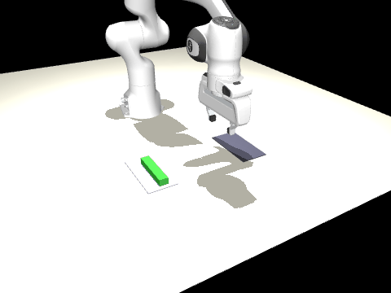

# Piloter un bras Panda simule avec mes propres videos

Projet pour le challenge stagiaire Humanoid. Les donnees sont des videos que j'ai filmees
moi-meme au telephone : je deplace une barre de cereales entre deux endroits de mon bureau
(vers une tablette posee a cote), 22 et 28 allers-retours dans deux videos de 2,5 min, avec un
marqueur ArUco de 10 cm pose sur la table pour avoir une echelle.



## Resultat en bref

| Methode | Taux de reussite |
|---|---|
| Rejeu direct des demos humaines par le robot (boucle ouverte, echantillon de 12 demos) | 12 / 12 |
| Politique apprise (clonage de comportement), demos gardees de cote | **19 / 20** |
| Politique apprise, positions de depart / arrivee aleatoires (+/- 4 cm, dans les deux sens) | **48 / 50** |

Reussite = la barre est posee a moins de 3 cm de la cible.

## Pipeline

| Etape | Script | Ce que ca fait |
|---|---|---|
| 0 | `00_calibration.py` | detecte le marqueur ArUco, calcule la transformation pixels -> metres sur la table |
| 1 | `01_suivre_objet.py` | suit la barre (couleur verte) image par image, en metres |
| 2 | `02_decouper.py` | decoupe la longue video en 100 demos (aller A->B ou retour B->A) |
| 3 | `03_retarget.py` | met les demos des deux videos dans le repere du robot, ralentit x3 |
| 4 | `04_rejouer_demos.py` | le robot rejoue chaque demo a l'identique (verifie que le retargeting est faisable) |
| 4b | `04b_expert_reactif.py` | expert qui decide a partir de l'observation, il genere les donnees d'apprentissage |
| 5 | `05_entrainer_bc.py` | clonage de comportement : petit MLP, observation (8 nombres) -> action (4) |
| 6 | `06_evaluer.py` | evalue la politique dans la simulation + GIF |

Fichiers utiles : `env_barre.py` (simulation MuJoCo, cinematique inverse),
`robot/` (scene + modele Panda de `mujoco_menagerie`, licence Apache 2.0).

## Lancer

```
pip install -r requirements.txt
python 00_calibration.py
python 01_suivre_objet.py
python 02_decouper.py
python 03_retarget.py
python 04b_expert_reactif.py     # quelques minutes, genere data/dataset_bc.npz
python 05_entrainer_bc.py
python 06_evaluer.py
```

Les videos de `data/videos/` sont compressees (540x960) a partir de mes originales
(1080x1920, 500 Mo). Le suivi donne le meme nombre de demos dans les deux cas.

## Choix de conception

**Marqueur ArUco plutot que des mesures a la main.** Il donne l'echelle et un repere fixe ; avec
ses 4 coins on calcule une homographie, ce qui marche aussi pour ma 2e video filmee en vue oblique.

**Suivi de la barre par sa couleur plutot que de la main.** Je pensais suivre la main avec
MediaPipe, mais ce qui compte pour le robot c'est la trajectoire de l'objet. La couleur verte
suffit, c'est simple et assez robuste (l'objet est vu sur 100 % des images).

**Decoupage par etats A / B.** Un premier decoupage avec un seuil de vitesse donnait des morceaux
parasites (la main ajuste la barre, le suivi bouge un peu). Projeter la position sur l'axe A-B
et couper quand on passe de A a B est bien plus propre.

**Pince Panda + cinematique inverse.** Le bras est commande par la position de la pince
(dx, dy, dz, ouvrir/fermer), la cinematique inverse (moindres carres amortis) en deduit les
7 angles.

## Ce qui a marche / pas marche

- **Premier expert, base sur le temps : le clonage echoue (0 %).** Le rejeu des demos attend
  "15 pas" avant de fermer la pince. Un reseau qui ne voit que l'etat ne sait pas ou il en est :
  il reste bloque au-dessus de la barre avec la pince a moitie ouverte. Solution : un expert
  reactif (`04b`) qui ne depend que de l'observation. Le clonage est passe de 0 a 95 %.
- **Commande en delta.** Au debut, je calculais `pince_reelle + delta`. Le bras s'affaisse un peu
  sous son poids et n'arrivait jamais a destination. Il faut ajouter le delta a la consigne
  precedente, pas a la position mesuree.
- **Pince trop faible.** La pince du modele serre a ~1,5 N, la barre glissait. J'ai multiplie
  la raideur de l'actionneur par 10.
- **Fermer trop tot.** Le robot fermait la pince avant d'etre vraiment arrive en bas (retard de
  suivi) et ecrasait la barre. Il faut attendre.

## Limites

- **Ce que l'humain apporte vraiment :** les positions de depart/arrivee (100 demos, avec leur
  dispersion) et le profil de vitesse pendant le transport. Les trajectoires humaines sont presque
  droites (deviation laterale mediane 2 cm), donc il y a peu de "forme" a copier. L'expert
  reactif utilise le profil de vitesse moyen de la main, pas chaque trajectoire.
- **L'orientation de la barre n'est pas suivie.** Elle est toujours dans le meme sens en simulation.
- **Pas d'image dans la politique :** elle voit directement la position de la barre et de la cible
  (vecteur d'etat), pas des pixels. Ce n'est pas un VLA.
- **Pas de transfert reel.** Tout est en simulation.
- **Ralenti x3 :** mes gestes durent 0,8 s, c'est trop rapide pour le bras simule.
- **Peu de donnees :** 2 videos, un seul operateur, un seul objet.
- Les 2 echecs sur 20 n'ont pas ete analyses en detail.

## Organisation des fichiers

- `data/videos/` : mes videos (compressees)
- `data/calibration/` : homographie de chaque video + image de controle
- `data/suivi/` : position de l'objet image par image
- `data/demos/`, `data/demos_robot/` : demos dans le repere du marqueur / du robot
- `modeles/bc.pt` : politique apprise
- `resultats/` : graphiques de controle, GIF
